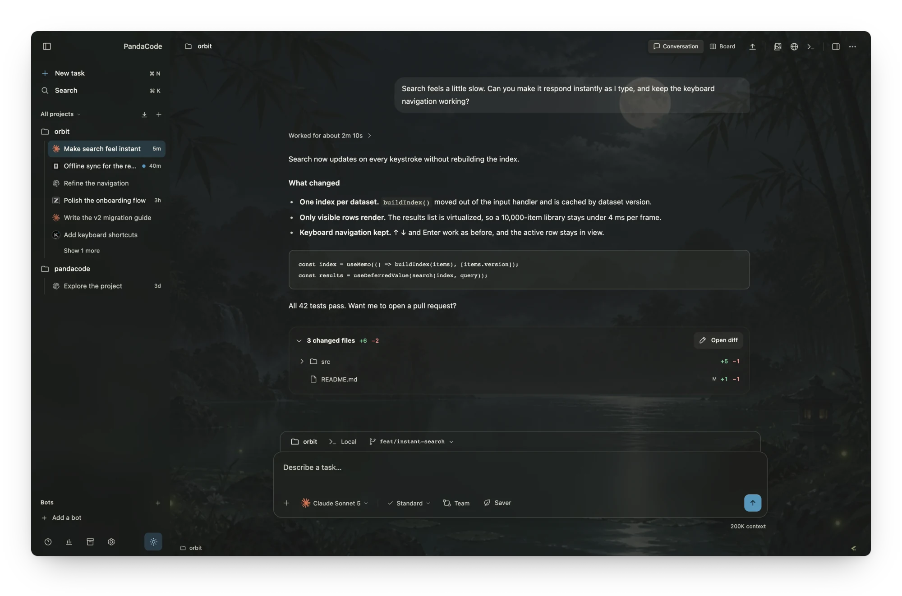
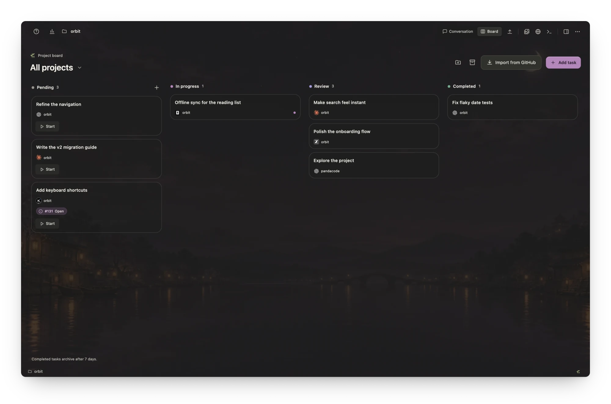
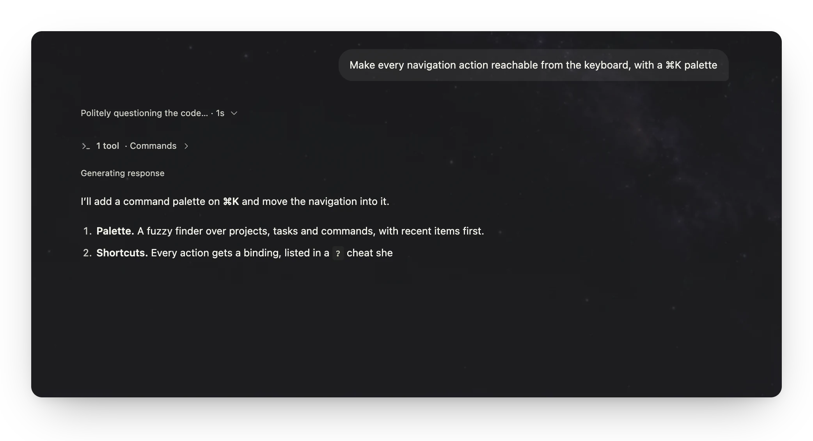
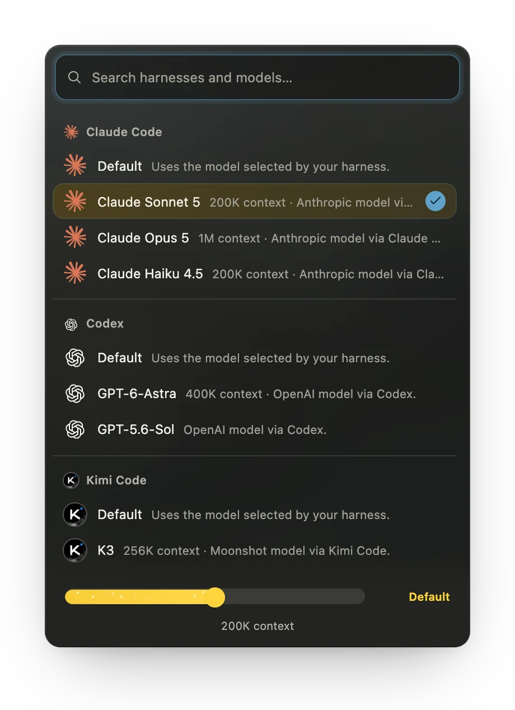
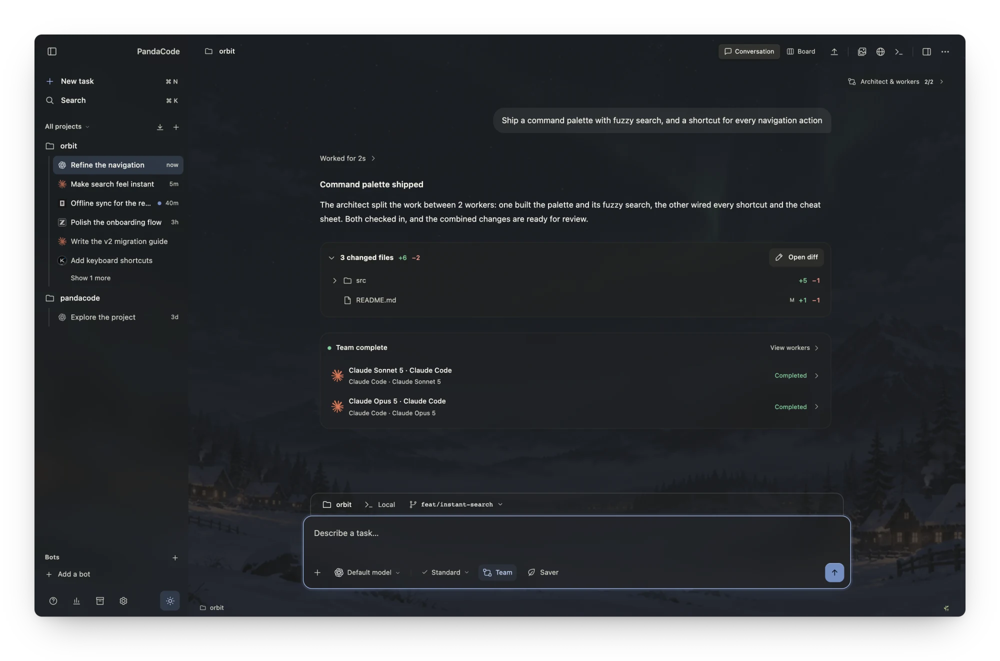
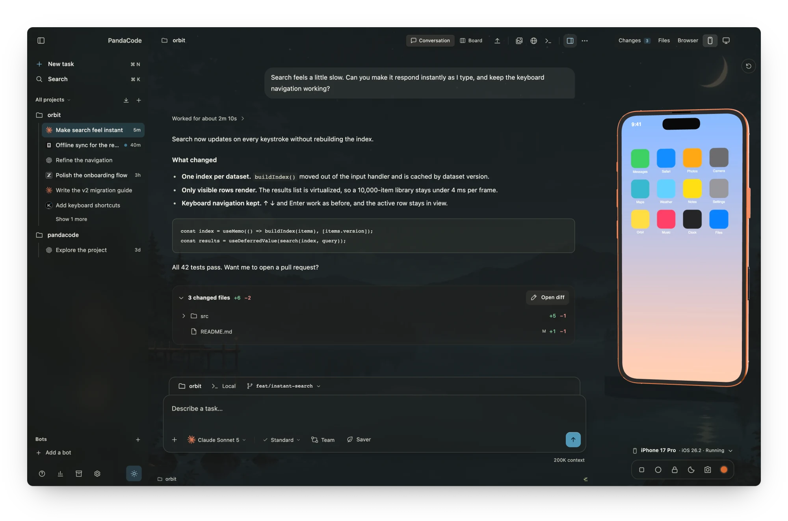
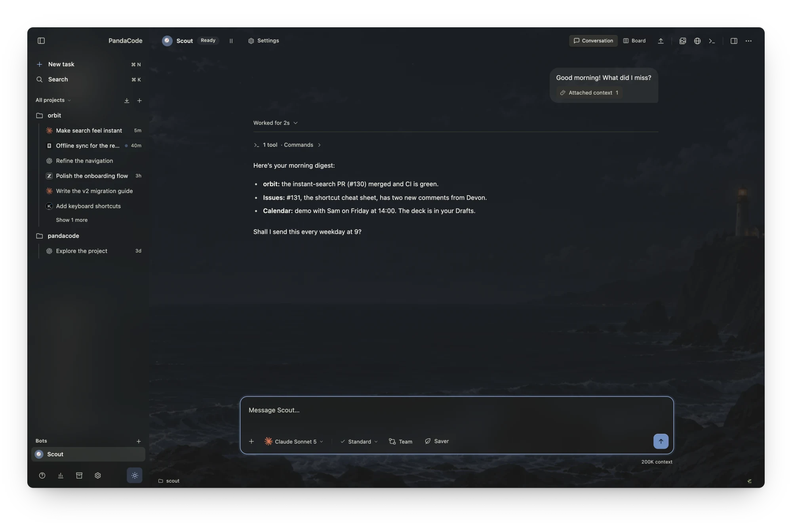
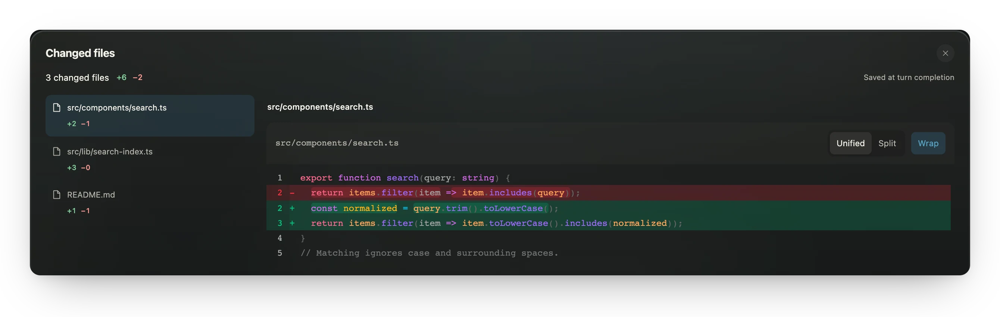
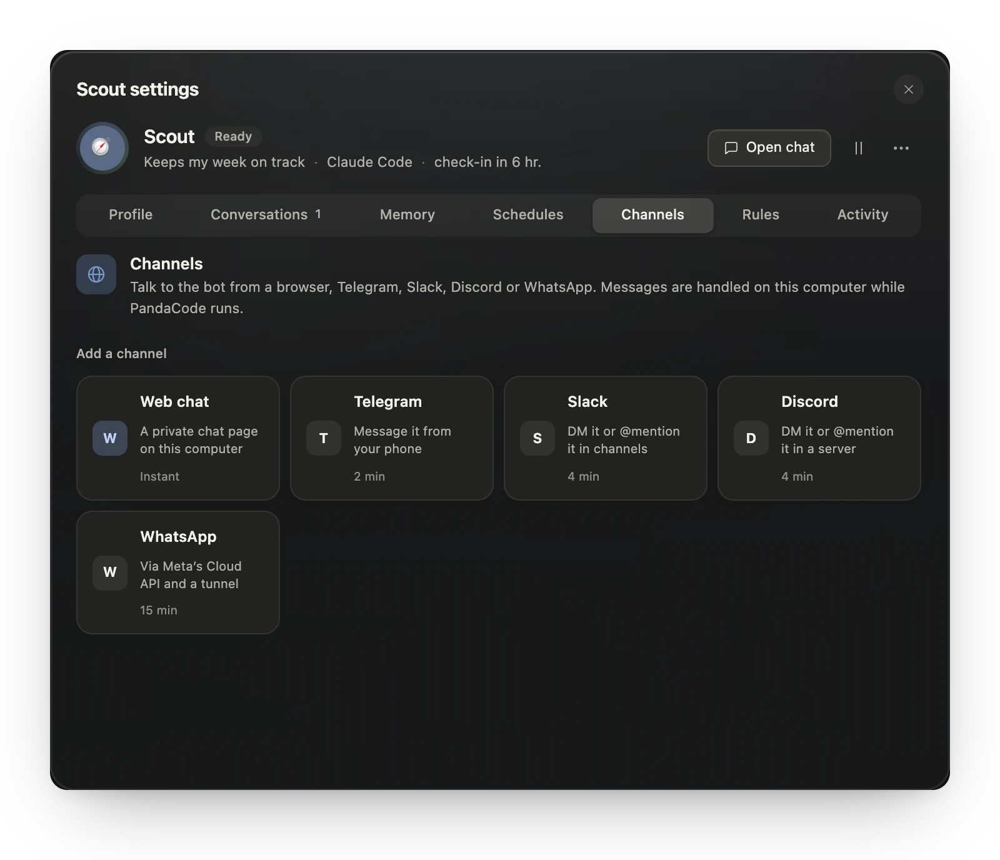

# PandaCode Extended

**PandaCode Extended** is a separately maintained distribution of [PandaCode](https://github.com/aicodeking/pandacode), with added features and reviewed security controls. The current Extended source candidate is [`0.6.0+pc.0.3.50`](releases/extended/0.6.0.md) (technical version `0.6.0`, tracked upstream reference `0.3.50`). It adds Connect and agent traces from upstream `0.3.49`–`0.3.50` to the previous integrations and historical feature reviews; see the [current integration map](docs/upstream-integration-0.6.0.md), [0.3.28–0.3.42 coverage](docs/upstream-parity-0.3.28-0.3.42.md), [coverage before 0.3.28](docs/upstream-parity-before-0.3.28.md), and [versioning policy](docs/VERSIONING.md). The canonical repository is [ginmp8/pandacode-extended](https://github.com/ginmp8/pandacode-extended).

Historical security work: [release notes](releases/extended/0.3.42-hardened.md), [upstream history](docs/UPSTREAM-RELEASE-HISTORY.md), and [security review](security-review/0.3.42-hardened/REPORT.md).

The [0.3.48 incremental review](docs/upstream-integration-0.5.1.md) adds a centered harness handoff disclosure and responsive regression tests. The earlier integration adds Devin CLI, sidebar sections, persistent inspector tabs with inline diffs, remote task progress and images, and richer desktop/mobile Connect behavior while retaining Extended's review tools, Browser QA, workflow library, connection isolation and security controls. Historical ancestry remains `0.3.28`; this is a reviewed integration of the mapped release range, not a claim that every earlier upstream feature or platform has been verified. Automatic updates and network installers remain disabled. The [read-only upstream release monitor](.github/workflows/upstream-version-watch.yml) detects newer official tags; it never downloads code or merges an upstream release automatically.

The historical supplement adds Kilo, Cline console support, explicit Claude-family approval review, Jev OpenRouter, bot personality and project-task bindings, local document tabs, compact mobile filters, relay guards and manual management for eleven additional cloud providers. It preserves protected secret storage and pinned-device trust. Automatic cloud-agent credential/checkout transport remains excluded; the [feature map](docs/upstream-parity-0.3.28-0.3.42.md) gives each inclusion and policy difference explicitly.

The earlier review maps 77 source notes from `0.2.0` through `0.3.27` and corrects optional Jev credential loading that could block workspace initialization. Saved configuration arrives asynchronously, and a delayed startup response cannot overwrite newer saved availability. OS-vault storage, atomic migration and recovery protection remain in place. The [earlier feature map](docs/upstream-parity-before-0.3.28.md) distinguishes inherited features, later replacements, security exclusions and platform-validation limits.

This is a fork of [PandaCode](https://github.com/aicodeking/pandacode). The license and upstream author attribution are preserved. Internal package names, the Tauri identifier (`ai.pandacode.desktop`), and user-data directories are deliberately unchanged. This preserves existing installations, but does **not** support installing Extended alongside original PandaCode without conflicts.

A small, native desktop workspace for coding agents. PandaCode runs the coding
CLIs you already use — **Claude Code, Codex, Kimi Code, OpenCode, GLM Coding
Plan and Xiaomi MiMo** (through Claude Code), **GitHub Copilot CLI, Antigravity,
xAI's Grok Build, DeepSeek, Command Code, Cline and Devin CLI** (through ACP), **Pi** and its
fork **omp** (through Pi's RPC mode), and Meta's **Muse Code** (through its MSP
protocol) — side by side, with your projects, Git, a
terminal and a browser in one window.

PandaCode is free and open source under the [PandaCode License](LICENSE), the MIT
License with one addition: forks that are used commercially or released publicly
must say "This is a fork of PandaCode" and link to the [original PandaCode repository](https://github.com/aicodeking/pandacode). There is no
account, no license key and no telemetry.

Built with Tauri 2, Rust, SQLite and plain TypeScript. It uses the operating
system's webview: no bundled Chromium, resident Node server, React runtime or
embedded editor engine.


<p align="center">
  
</p>

## Features

- **Every harness in one place.** Pick the harness, model and reasoning effort
  per task; switch between them from the composer. See [providers](docs/providers.md).
- **Tasks and a task board.** Parallel tasks across projects, a Pending → In
  progress → Review → Completed [board](docs/task-board.md), message queueing
  and steering while an agent runs. The sidebar groups Active, Needs review and Completed tasks, with row actions for completion, archive and deletion.
- **Agent teams.** An [architect and up to three workers](docs/architect-workers.md),
  mixing harnesses and models, or named team profiles. Each spawned worker is one
  line in the turn that started it; click it to open the worker.
- **Model routing.** In automatic teams (Cheap, Balanced or Best, from the Team
  button) the lead can let a local router pick each worker's model, in about 10–25 ms
  and without sending the task anywhere; a failed worker's replacement escalates to a
  stronger model. See
  [model routing](docs/model-routing.md).
- **Bots.** Put an agent behind Telegram, Slack, Discord, WhatsApp or a local web
  chat; each conversation is an ordinary task. The sidebar's **Bots** view lists
  every bot with its latest message. This fork adds ten built-in panda icons, local image uploads cropped to 128px PNG, and reorganized bot settings. See [bots](docs/bots.md).
- **Native system tray.** Optional OS tray menu lists running, waiting and recently finished tasks; plan usage is refreshed only when the menu is opened or its refresh action is used.
- **Local VMs and cloud sandboxes.** Headless macOS/Linux VMs on Apple silicon
  (Tart), and Daytona, Cloudflare and AWS sandboxes that agents can drive.
- **Cloud agents.** Pick a cloud provider in a New task's **Run on** menu and the
  agent runs on a machine in your own account (Daytona, Cloudflare, AWS, Google Cloud,
  E2B, Modal, Vercel Sandbox, CodeSandbox, Runloop, Blaxel, Tensorlake, Freestyle,
  boat). PandaCode installs the harness there, copies your login, and keeps the run
  going while your laptop sleeps; changes come back to a local worktree. See
  [cloud agents](docs/cloud-agents.md).
- **Simulators.** iOS Simulator and Android emulator tools for agents.
- **Deploys.** Start a deploy task for Vercel, Cloudflare, Railway, Netlify, AWS or Google
  Cloud from the header ([Netlify setup](docs/netlify.md)), with approval-gated CLI runs (AWS and Google Cloud use
  your installed CLI and its login).
- **GitHub view.** Your repositories with their threads, pull requests and issues;
  review, fix checks, merge or solve an issue in one click. Each opens as a linked
  thread beside the GitHub view, where you can keep chatting. See [GitHub](docs/github.md).
- **Git and worktrees.** Diffs, staging, commits, per-task [worktrees](docs/worktrees.md)
  with a one-click local **Merge into main**, branch switching from the branch chip,
  and optional [GitHub](docs/github.md) issues and pull requests through `gh`,
  including merging a task's linked pull request.
- **Approvals at hand.** Requests wait in a slim bar above the prompt, one line
  each, grouped with **Approve all** when there are several.
- **Find in thread.** `⌘/Ctrl F` searches your messages and the agent's, with
  every match highlighted.
- **Review every turn.** Saved [turn changes](docs/turn-changes.md) with
  unified/split diffs, an embedded [browser](docs/browser.md), and file previews. The inspector remembers its open tabs and Changes shows file diffs together with staging controls.
- **Extended review tools.** [Review & coordination](docs/HARDENED-REVIEW-TOOLS.md), [Browser QA](docs/HARDENED-BROWSER-QA.md), and workflow templates remain available through their existing controls.
- **Token saver.** Per-task response-style packs that cut output tokens.
- **Quick overlay.** A global shortcut (default ⌘/Ctrl + Shift + Space) opens a
  launcher for new and running tasks from anywhere.
- **Agent usage.** Account limits and cost estimates for each installed harness
  ([agent usage](docs/agent-usage.md)); updates are manual in this revision
  ([agent updates](docs/agent-updates.md)).
- **Attachments.** Images, PDFs, documents, folders and a built-in mockup
  sketcher ([attachments](docs/attachments.md)).

## Screenshots

**A board for everything in flight.** Tasks from every project move from Pending to
Review, each with its harness, model and linked issue.



<table>
  <tr>
    <td width="62%" valign="top"><br><sub><b>Live replies.</b> Responses stream in as Markdown, with tool activity folded above.</sub></td>
    <td width="38%" valign="top"><br><sub><b>Any harness, any model.</b> Switch per task, with context size and reasoning effort.</sub></td>
  </tr>
</table>

**Agent teams.** An architect plans the work, runs workers in parallel across
harnesses, and reviews what they bring back.



**Your app beside the chat.** The iOS Simulator and Android emulator run in the
inspector on a lifelike device, so you can tap through what an agent just built.



**Bots that keep working.** A bot's conversation is an ordinary task thread, with
the same streaming, composer and model picker; reach it from Telegram, Slack,
Discord, WhatsApp or a browser too.



<table>
  <tr>
    <td width="58%" valign="top"><br><sub><b>Review every turn.</b> Each turn saves its changes, with unified and split diffs.</sub></td>
    <td width="42%" valign="top"><br><sub><b>Bot settings.</b> Memory, schedules, channels and rules, in one place.</sub></td>
  </tr>
</table>

<sub>Screenshots come from the browser preview with sample data. Regenerate them with
`npm run screenshots` (see [`scripts/screenshots`](scripts/screenshots/capture.spec.ts)).</sub>

## Privacy and security policy

Projects and conversations are stored locally. Prompts, attached code and tool
results can go to the AI provider or CLI you choose; this application is an AI
orchestrator, not an operating-system network sandbox. Explicit browser,
GitHub, cloud and bot integrations also communicate with their selected services.
The review found no hidden instruction deliberately exporting secrets to a
separate collection service. This is a bounded source review, not a guarantee
about every provider binary, external plugin or future dependency.

| Feature | Policy in this revision |
| --- | --- |
| Windows installer | No WebView2 download; existing runtime required; per-user installation. |
| Release packaging | Cargo lockfile enforced; no updater artifacts, update signing credentials or automatic publication workflow. |
| Application updater | Removed from native plugins, capabilities and dependencies; the UI cannot enable it. |
| Agent update checks/installers | Disabled in frontend and native commands; update a reviewed version manually outside PandaCode. |
| Cost estimates | Use the saved or bundled price list without downloading a refresh; estimates may be stale. |
| Jev credentials | Saved in the OS credential vault; an unavailable vault blocks migration/use instead of silently writing plaintext. |
| Bot notifications | Explicit outbound notify tool always requests approval, including Full access; scheduled summaries remain on the desktop. Replies to an active channel conversation still go to that channel. |
| Project file previews | HTML/CSS/images display with scripts, fetch, forms and external navigation blocked. The ordinary browser remains available for a site you explicitly open. |
| Connect | Optional GitHub/relay sign-in; hardened peers required at both ends. Sign out to disconnect fully. |
| Deploy CLIs | Must be installed manually first; credential-bearing tool invocations reject endpoint/TLS redirection flags. |
| Local VM desktop | Install only through the explicit Add a desktop action; no background installation on VM start. |

## Install this revision

Read [the installation security review](SECURITY-INSTALLATION-REVIEW.md) and
[Windows build/install instructions](docs/install-windows-hardened.md). The
installer never downloads WebView2; install the Microsoft runtime separately
if it is missing. The Avast alert has not been reproduced or attributed.


This archive contains source code, not a prebuilt Windows/macOS installer.
Use the local build instructions below, on the target operating system. Keep the
included lockfiles. Installing an upstream release or running the public
`npx pandacode` package replaces these protections with upstream behavior.
The copy of the npx installer included here refuses downloads and installation.

Dependency lifecycle scripts are off by default through the repository `.npmrc`.
Keep using `npm ci --ignore-scripts`; this is not a sandbox for explicit build
commands or Rust build scripts. Dependency acquisition and build tooling can
still require network access.

Updates are a deliberate manual operation: review the new source, reproduce
these protections, build it, and then replace the installed application. The
package version is `0.5.1` (displayed as `0.5.1+pc.0.3.48`); this is
an independently labeled fork distribution, not an official upstream release.
Back up application data before replacing a previous installation.

Then install Git and at least one coding CLI and sign in with its normal login.
PandaCode does not include provider plans or usage.

[Pi](https://github.com/earendil-works/pi) installs with `npm i -g @earendil-works/pi-coding-agent`; sign in through Pi's own CLI. PandaCode drives it over Pi's RPC mode and gives it PandaCode's app tools through a local loopback bridge extension. Pi has no approval system of its own, so PandaCode's extension enforces the permission modes; the integrated console needs Full access.

[omp (Oh My Pi)](https://github.com/can1357/oh-my-pi), a Pi fork that runs on Bun, installs with `bun install -g @oh-my-pi/pi-coding-agent`; sign in through `omp` itself. PandaCode drives it with the same RPC bridge as Pi and passes `--approval-mode yolo` so the bridge stays the only approval gate.

[DeepSeek](https://platform.deepseek.com/api_keys) installs with `npm i -g @deepseek-ai/dsh`; PandaCode launches `dsh --profile acp`. An API key is optional (Settings → Providers, or `DEEPSEEK_API_KEY`); dsh can use its own stored credentials. With a saved key (or `DEEPSEEK_API_KEY`), the Usage dialog shows the account balance from `api.deepseek.com`.

[Command Code](https://commandcode.ai/docs/acp) installs with `npm i -g command-code` (Node 22 or newer); PandaCode launches `command-code acp`. Sign in once with `command-code login`, or save an API key in Settings → Providers (or set `COMMAND_CODE_API_KEY`); either one authenticates the same account. Usage limits are not shown in PandaCode; check Command Code Studio.
[Cline](https://docs.cline.bot/usage/cli-overview) installs with `npm i -g cline`; PandaCode launches `cline --acp`. Sign in once with `cline auth` (or set `CLINE_API_KEY`); the provider and models chosen in Cline apply. See [provider details](docs/providers.md#cline).

[Kilo Code](https://kilo.ai/docs/code-with-ai/platforms/cli) installs with `npm i -g @kilocode/cli`; sign in with `kilo auth login`, then select **Kilo Code** in PandaCode. PandaCode launches `kilo acp` and uses Kilo's configured providers and models. See [provider details](docs/providers.md#kilo-code).

Muse Code installs with Meta's launcher into `~/.local/bin/muse`; run `muse login` once in a terminal. PandaCode launches `muse serve` and speaks MSP, Muse's JSON-RPC session protocol, with its sandbox and approval modes; see [docs/providers.md](docs/providers.md#muse-code) for what each mode does and what Muse cannot express.

[GitHub Copilot CLI](https://docs.github.com/en/copilot/how-tos/set-up/install-copilot-cli) installs with `npm install -g @github/copilot`; run `copilot login` in a terminal, then select **GitHub Copilot CLI** in PandaCode. PandaCode launches the local `copilot` executable over ACP. The CLI manages its own sign-in. See [provider details](docs/providers.md#github-copilot-cli).

[Devin CLI](https://docs.devin.ai/cli) installs with `curl -fsSL https://cli.devin.ai/install.sh | bash` (or `brew install --cask devin-cli`, or the copy bundled with Devin Desktop); run `devin auth login` once in a terminal, then select **Devin CLI** in PandaCode. PandaCode launches `devin acp` with the CLI's own sign-in and lists every Devin model with its own thinking levels. See [provider details](docs/providers.md#devin-cli).

[ZCode](https://github.com/zai-org/ZCode) installs with its install script (`~/.local/bin/zcode`, Node 24); run `zcode` once in a terminal and sign in, then select **ZCode** in PandaCode. PandaCode talks to `zcode app-server` directly — the CLI's own protocol, since it exposes no ACP mode — listing every model the account can reach with its own reasoning levels. See [provider details](docs/providers.md#zcode).

[Hermes Agent](https://hermes-agent.org) installs with `curl -fsSL https://raw.githubusercontent.com/NousResearch/hermes-agent/main/scripts/install.sh | bash`; run `hermes acp --setup` or configure `~/.hermes/config.yaml`, then select **Hermes Agent** in PandaCode. PandaCode launches `hermes acp` and uses Hermes' configured provider and models. See [provider details](docs/providers.md#hermes-agent).

## Build from source

You need Node.js 22 or newer, stable Rust 1.88 or newer, and the
[Tauri prerequisites](https://v2.tauri.app/start/prerequisites/) for your OS.

```sh
cd pandacode-extended
npm ci --ignore-scripts
npm run build
npm run package
# For a Windows x64 installer with a distinct Extended 0.5.1 asset name:
# npm run release:build -- windows-x86_64
# For local development: npm run desktop
```

`npm run dev` serves only the frontend. In a regular browser it runs a labeled,
device-local sample workspace for UI work; files, Git and terminals are
simulated there. `npm run package` makes a local platform bundle, and
`npm run release:build` builds the release asset for your OS (see
[releasing](docs/releasing.md)).

The website lives in [website/](website/): `npm run site:dev` and
`npm run site:build`.

## Use

Open a project folder, then click **New task** or press `⌘/Ctrl N`. A centered
"What should we build in …?" page opens in the last active project with the
message box focused. Choose the harness and model from the searchable picker in
the message box; new tasks remember your last choice. The **+** button attaches
images, documents, folders, project files or a mockup. Open **Changes** to
inspect and stage diffs, or the terminal to run shell commands. Conversations
and provider session IDs persist across restarts; agents start only for active
turns.

In **Files**, click an HTML, SVG, image or PDF to open it in the sidebar browser.
Filenames mentioned in responses become clickable and resolve against the task's
own project or worktree. Local file previews are static in this revision: project
JavaScript and outbound connections do not run inside the preview.

The bar above the prompt shows the project, checkout and branch. Its branch chip
is the one place for [worktrees](docs/worktrees.md): an unstarted task moves into
a new worktree in place, a started one spawns a sibling task, and settling a
clean worktree task offers to remove its checkout and merged branch.

Choose **Board** in the header to manage tasks by status. Choose **Team** in the
composer for an automatic team, or set up an architect and workers. Each turn's
tool calls sit inside a compact **Worked for …** row; final answers and errors
stay visible, and approval requests wait in the bar above the prompt.

The branch chip also switches the project checkout to `main` or another local
branch, and in a worktree task offers **Merge into main**: it merges the
worktree's committed work locally, refuses uncommitted changes or conflicts
without touching anything, then offers to remove the worktree.

**Standard** permissions keep each provider's native checks. Claude's **Accept
edits** allows its editing tools; Codex uses its workspace sandbox with
on-request approvals. **Full access** enables the harness's broadest mode. See
[provider details](docs/providers.md).

Type `/` at the start of a message for the harness's commands and skills
([slash commands](docs/slash-commands.md)).

Keyboard shortcuts: `⌘/Ctrl N` new task, `⌘/Ctrl K` command palette,
`⌘/Ctrl J` terminal, `⌘/Ctrl B` sidebar, `⌘/Ctrl ,` settings, `⌘/Ctrl F` find
in thread (`⌘/Ctrl G` next match), `Enter` send (queues while an agent runs),
`⌘/Ctrl Enter` steer, `Shift Enter` newline, `⌘/Ctrl +/−/0` interface size (the
whole interface scales, not just text).

On macOS, if folder access is denied, use **Browse** to select the folder, or
allow PandaCode under **System Settings → Privacy & Security → Files & Folders**.

PandaCode includes [21 anime scenery wallpapers](docs/wallpapers.md), a
different morning, afternoon and night scene for each weekday. **Settings →
Daily wallpapers** turns them off. You can also import VS Code color themes.

The [optional Jev add-on](docs/jev.md) adds work review, project-rule checks and
app testing in isolated Chrome profiles. It is off by default and PandaCode works
fully without it.

## Resource limits

No background directory polling or recursive file watchers. Agents exit after
each turn and resume by provider session ID. After a Claude Code turn, the next
turn's process starts in the background so a follow-up skips the CLI's startup;
at most two wait at a time, each for up to 10 minutes. PandaCode's fixed
instructions go to Claude-family harnesses once as a cached system prompt rather
than in every message. The interface has no transitions: everything appears at
once, and a thread you return to is drawn in a single frame. Terminal and Markdown code load only
when needed. Terminal history, provider frames, files, diffs and streamed text
all have explicit limits; only the current 100-message page of a conversation is
loaded. **Resource usage** reports native core RSS, active agents, terminals and
database size (core RSS excludes the system webview and provider processes).

## Tests

```sh
npx tsc --noEmit           # typecheck
npm run build && npm test  # unit tests (some read dist/)
npm run test:release       # release script tests
npm run test:rust          # cargo test
npx playwright test        # browser suite (Chrome)
npx playwright test -c playwright.webkit.config.ts   # WebKit
```

Ordinary tests make no paid model calls. Opt-in live tests are `#[ignore]`d;
see [providers](docs/providers.md).

## Contributing

Contributions are welcome. Read [CONTRIBUTING.md](CONTRIBUTING.md) for setup and
the pull request process, and [AGENTS.md](AGENTS.md) for code conventions. Please
follow the [Code of Conduct](CODE_OF_CONDUCT.md), and report security issues
privately as described in [SECURITY.md](SECURITY.md). Bugs and ideas for Extended go in
[Extended GitHub issues](https://github.com/ginmp8/pandacode-extended/issues). For issues specific to the original PandaCode, use [upstream issues](https://github.com/aicodeking/pandacode/issues).

Architecture notes: [design](docs/design.md), [native IPC](docs/ipc.md),
[research](docs/research.md). Provider protocols live in
`src-tauri/src/providers.rs` behind one normalized event interface; ACP harnesses
share `acp.rs`.

## Data

Data lives in Tauri's per-user application data directory (on macOS,
`~/Library/Application Support/ai.pandacode.desktop/`) in `kingcode.sqlite3`; the
database keeps its legacy internal name. Project source stays in the folders you
open, and removing a project from the app never deletes its files.

## License

[PandaCode License](LICENSE) (MIT with an attribution requirement for forks) ©
2026 PandaCode contributors. Provider names and logos belong to
their owners and do not imply endorsement ([brand assets](docs/brand-assets.md)).
