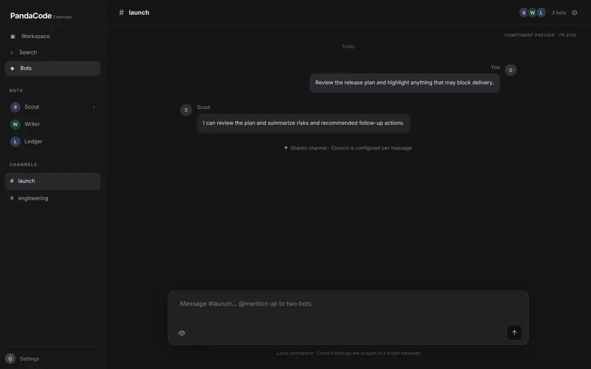
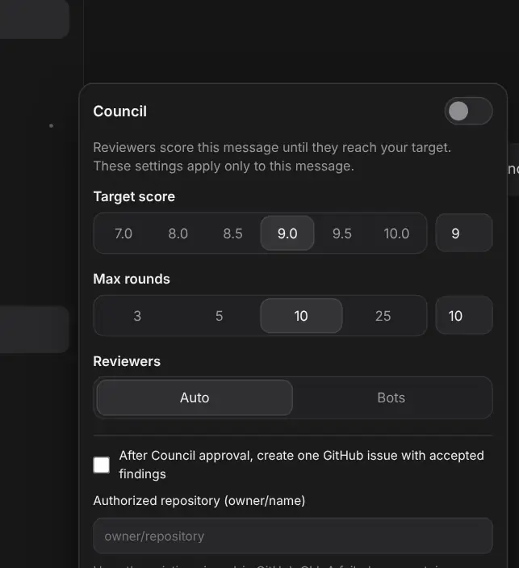
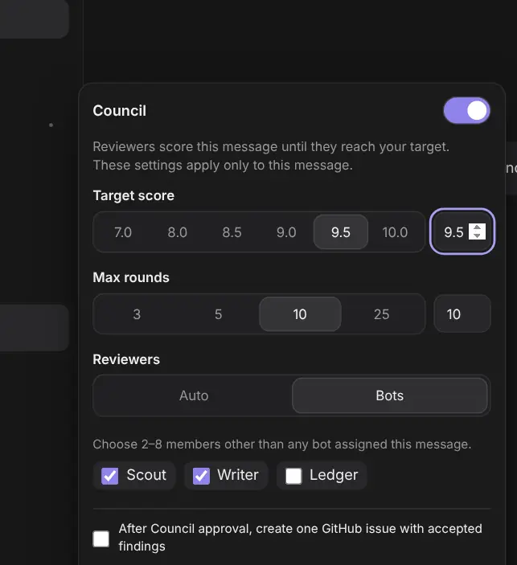
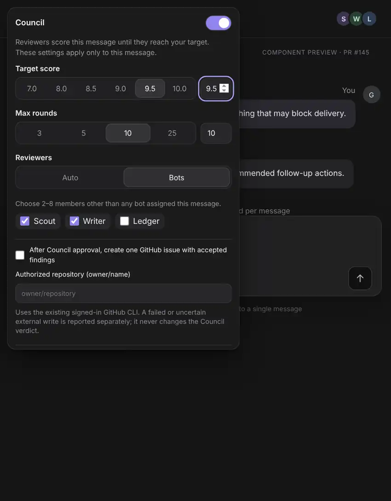

# Shared Channel Council: footer popover (PandaCode Extended)

This guide covers configuring **Council for one message in a local Shared Channel**. The Council controls sit in a floating panel opened from the scales icon in the channel message composer, rather than an inline form that pushes the message field down.

**Availability:** This UI is part of the Extended-only [PR #145](https://github.com/ginmp8/pandacode-extended/pull/145) feature candidate. It is not an upstream PandaCode feature or evidence of an already released desktop build.

> **About the images:** The four images below are browser-rendered **component previews** of PR #145, not screenshots captured in a running PandaCode desktop installation. The repository copies are WebP-sized/cropped derivatives of those previews; their sample bots, messages and settings are illustrative. They demonstrate layout, not real harness execution.

## Open Council for a message

1. In **Bots**, open an active local Shared Channel that has members (for example, `#launch`).
2. Compose a message. If the message should be assigned to particular channel bots, mention up to two of them by name using `@mentions`.
3. Click the **scales/Council icon** at the bottom of the composer. This opens the floating Council panel without expanding an inline settings form.
4. Turn on the **Council** switch, choose a score and round limit, and select how reviewers will be assigned.
5. Close the panel by clicking its icon again, clicking outside the popover, or pressing **Escape**; then send the message. There is no separate Save button. The settings are submitted with this message.

The toolbar icon reports **Council: off** or **Council: on**, reflecting whether the switch is enabled. Merely opening the panel does not enable Council.

*Figure 1 — Compact composer when the per-message Council panel is closed (component preview).*

## Configure scoring and reviewers

| Setting | Initial value | Controls and requirements |
| --- | --- | --- |
| Council | Off | Explicitly enable for the message that you are about to send. |
| Target score | `9.0` | Presets: `7.0`, `8.0`, `8.5`, `9.0`, `9.5` and `10.0`. A custom numeric field is available; valid values are from 1 to 10. |
| Max rounds | `10` | Presets: `3`, `5`, `10` and `25`. A custom integer field accepts 1 to 100 rounds. |
| Reviewers | **Auto** | **Auto** uses the native Council reviewer selection. **Bots** lets you choose **2–8** eligible channel members explicitly. |

The selected preset is highlighted and the adjacent numeric field reflects it. Entering a custom number updates the preset highlight without discarding the value.

*Figure 2 — Floating settings panel; the underlying channel composer remains separate (component preview).*

When using **Bots**, select 2–8 distinct channel members. A bot assigned to execute the message cannot also review it. If too few eligible reviewers are available, adjust the channel membership or choose **Auto**. Selection identifies configured bots rather than creating new bot profiles.

*Figure 3 — Explicit reviewer selection for an individual message (component preview).*

## Optional permissions and follow-up

These are independent, opt-in choices. Neither is enabled simply by opening the panel.

- **Post-acceptance GitHub issue:** Check **After Council approval, create one GitHub issue with accepted findings**, then enter the exact authorized `owner/repository`. The app uses the existing signed-in GitHub CLI and attempts a post-approval write. A failed or uncertain external write is reported separately and does not alter the Council verdict.
- **Scoped native file inspection (Bots mode):** Check **Allow one exact native file-inspection action** and specify a relative file path such as `src/example.ts`. This authorizes the narrowly scoped `pandacode_open_file` action for that path only. It does **not** authorize shell commands, checkout changes or unrestricted tool access.

The composer validates the score range, integer round limit, selected reviewer count, executor/reviewer separation and applicable path/repository inputs before dispatching an enabled Council request. Rejected settings show an error instead of silently relaxing the constraint. For the underlying reviewer authority and security boundary, see [native reviewer security (S1)](reviewer-security-s1.md) and [selected reviewers (S2)](council-selected-bots-s2.md).

## What happens after sending

Council settings apply to **the submitted message**, not to the Shared Channel, bot settings or later messages. Deliveries in the channel timeline can show an independent Council status, current round, minimum score and report/acceptance actions when available. Other channel messages and their deliveries do not inherit the Council configuration.

If the channel composer is re-rendered **while the unsent message remains on the same channel**, its Council inputs are restored and the panel stays closed. This is an in-memory draft behavior, **not** a promise of persistence across app restarts or a way to change a previously dispatched Council cycle.

The panel uses a non-modal popover. Keyboard focus moves to its switch when opened; pressing **Escape** dismisses it and returns focus to the footer icon. It is repositioned to fit within the viewport as the window resizes.

*Figure 4 — Narrow-window layout, with the Council panel constrained to the available viewport (component preview).*

## Troubleshooting

| Situation | What to check |
| --- | --- |
| The Council icon is absent | The channel must be active and have members. Archived or empty channels do not render this composer. |
| Council was not included with the sent message | Confirm the panel's Council switch is on before sending; opening the panel alone is insufficient. |
| Selected reviewers cannot be submitted | Choose 2–8 eligible members, excluding any bot assigned to execute the same message. |
| Target or round limit is rejected | Set the target between 1 and 10 and rounds to an integer between 1 and 100. |
| File inspection is rejected | Use a nonempty relative path with no parent-traversal segment; absolute paths and drive-qualified paths are not accepted. |
| GitHub issue creation fails | Verify the exact `owner/repository` and the existing GitHub CLI authentication and permissions. Approval and the external write have separate outcomes. |

For implementation details and test coverage, see the [engineering reference](shared-channel-council-engineering.md). For Shared Channel collaboration and routing, see [Extended bot collaboration](extended-bot-collaboration.md).
